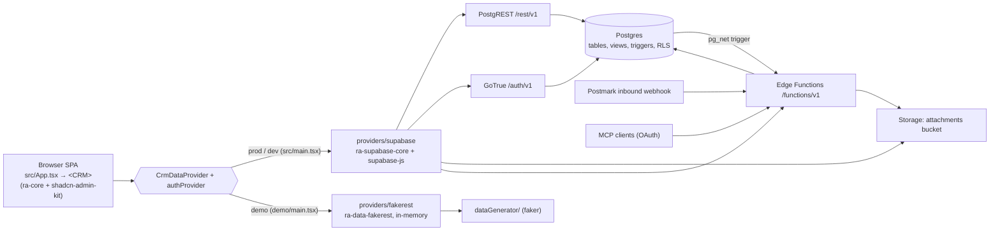

# Architecture

How the system is put together and how data flows. Paths are repo-relative. Read this before touching code; read `AGENTS.md` for commands.

## 1. Overview

The frontend is a static SPA (hash routing, `base: "./"`) built by Vite. All app logic goes through one `CrmDataProvider` (ra-core `DataProvider` plus custom methods) and one `AuthProvider`, passed as props to `<CRM>`. In prod/dev these talk to Supabase (PostgREST for CRUD on tables and views, Auth, Storage, Edge Functions for privileged ops). In the demo build the same `<CRM>` gets the FakeRest providers: random data generated in the browser, lost on reload, no network calls. DB-side logic (views, triggers) is re-implemented in JS for FakeRest, so behavior changes must land in both providers.

## 2. Repository map

| Path | What |
|---|---|
| `src/main.tsx`, `src/App.tsx` | Prod/dev entry; renders `<CRM />` with Supabase providers by default |
| `demo/main.tsx`, `demo/App.tsx` | Demo entry; `<CRM>` with FakeRest providers + `memoryStore()` |
| `index.html` | Single HTML template; `<%= mainScript %>` injected per Vite config |
| `src/components/atomic-crm/` | The CRM app, one folder per domain (see §3) |
| `src/components/atomic-crm/root/` | `CRM.tsx` (composition root), configuration context/defaults |
| `src/components/atomic-crm/providers/` | `supabase/`, `fakerest/`, `commons/` (shared logic, i18n, canAccess) |
| `src/components/atomic-crm/types.ts` | Domain types (`Contact`, `Company`, `Deal`, `Sale`, `Task`, notes, `Activity`, `SearchResult`) |
| `src/components/admin/` | shadcn-admin-kit (ra-core bindings: List, Form, inputs, fields). Mutable, edit in place |
| `src/components/ui/` | shadcn/ui primitives (`base-vega` style, Base UI). Mutable |
| `src/components/supabase/` | Auth pages: set/forgot password, OAuth consent |
| `src/hooks/`, `src/lib/` | Generic hooks (`use-mobile`, bulk export, saved queries) and utils (`cn`, `toSlug`) |
| `src/test/StoryWrapper.tsx` | Test/story harness: `<CRM>` over FakeRest with a seeded `Db` |
| `supabase/schemas/` | Declarative DB schema, source of truth (01..08 SQL) |
| `supabase/migrations/` | Generated migrations (applied in order) |
| `supabase/functions/` | Deno Edge Functions + `_shared/` (auth middleware, admin client, Kysely db) |
| `supabase/config.toml`, `config.e2e.toml` | Local Supabase (ports 543xx) and isolated e2e instance (ports +20) |
| `supabase/seed.sql`, `supabase/templates/` | Seeds `favicons_excluded_domains`; auth email templates |
| `e2e/` | Playwright specs + `fixtures.ts` (DB reset via service role) |
| `test-data/` | Sample CSVs for manual import |
| `doc/` | Astro/Starlight user + developer docs (`doc/src/content/docs/developers/*.mdx`) |
| `scripts/` | Registry generation, gh-pages deploy, remote Supabase init |
| `.storybook/` | Storybook config (`*.stories.tsx` live next to components) |
| `.github/workflows/` | `check.yml` (CI), `claude.yml` (@claude bot) |
| `registry.json` | shadcn registry manifest, regenerated by pre-commit hook |

## 3. Frontend

**Entry.** `src/main.tsx` → `src/App.tsx` → `<CRM />` (`src/components/atomic-crm/root/CRM.tsx`). The demo uses `demo/main.tsx` → `demo/App.tsx`.

**`<CRM>` props** (`CRMProps` in `root/CRM.tsx`): `dataProvider`, `authProvider`, `i18nProvider`, `store`, `dashboard`, `layout`, `disableTelemetry`, plus every `ConfigurationContextValue` field (`companySectors`, `currency`, `dealCategories`, `dealPipelineStatuses`, `dealStages`, `noteStatuses`, `taskTypes`, `title`, `darkModeLogo`, `lightModeLogo`); anything else spreads onto shadcn-admin-kit `<Admin>`. Defaults: `root/defaultConfiguration.ts`; Supabase providers; `localStorageStore(undefined, "CRM")`.

**Runtime configuration.** Domain lists (stages, sectors, etc.) are not read from props at runtime: props only seed the ra-core store key `app.configuration` once (`root/ConfigurationContext.tsx`). Components read `useConfigurationContext()` (store merged over defaults). `useConfigurationLoader()` (called in `layout/Layout.tsx`) fetches `dataProvider.getConfiguration()` (singleton `configuration` row, id=1) and overwrites the store; `CRM.tsx` also prefetches it on `login`/`handleCallback` and clears it on `logout`. Admins edit it in `settings/SettingsPage.tsx`.

**Composition.** `CRM` picks `DesktopAdmin` or `MobileAdmin` via `useIsMobile()` (`src/hooks/use-mobile.ts`, <768px).
- Desktop resources: `deals` (list only; create/edit/show are dialogs routed inside `deals/DealList.tsx`), `contacts`, `companies`, `sales` (list/create/edit), and headless `contact_notes`, `deal_notes`, `tasks`, `tags`. Custom routes: `/profile`, `/settings`, `/import`, `/changelog`; no-layout routes: `/sign-up`, confirmation, `/set-password`, `/forgot-password`, `/oauth/consent`.
- Mobile resources: `contacts` (list/show + `:id/notes/:noteId`), `companies` (show), `tasks` (list); routes `/settings`, `/changelog`. Uses a `PersistQueryClientProvider` (react-query cache persisted to `localStorage`, offline-first).
- `loginPage={StartPage}` (`login/StartPage.tsx`), `requireAuth`.
- Routing: ra-core `AdminRouter` default (HashRouter), so URLs are `#/contacts/1`.

**Layout.** Desktop: `layout/Layout.tsx` (top `Header.tsx` nav tabs Dashboard/Contacts/Companies/Deals, global search, user menu; wraps `DataImportProvider`, error boundary, `Notification`). Mobile: `layout/MobileLayout.tsx` + `MobileNavigation.tsx`. Dashboard: `dashboard/Dashboard.tsx` / `MobileDashboard.tsx`.

**i18n.** `providers/commons/i18nProvider.ts`: ra-i18n-polyglot, English + French, locale from `navigator.languages`, `allowMissing: true`. CRM strings in `providers/commons/englishCrmMessages.ts` and `frenchCrmMessages.ts` (keys like `resources.contacts.name`). Add every new UI string to both.

**Theming.** Tailwind v4 CSS variables in `src/index.css` (`:root` and `.dark`). Light/dark/system toggle via `src/components/admin/theme-provider.tsx` (store key `theme`, toggles `html.light|dark`). Logos/title come from configuration.

**Resource folder pattern** (e.g. `contacts/`):
- `index.ts(x)` default-exports `{ list, show, edit, create, recordRepresentation }` spread into `<Resource>`.
- `XList.tsx` (uses `@/components/admin/list`), `XListFilter.tsx` (sidebar of `ToggleFilterButton`s in `filters/FilterCategory`), `XListContent.tsx`.
- `XShow.tsx`, `XAside.tsx` (sidebar on show/edit), `XEdit.tsx`, `XCreate.tsx`, `XInputs.tsx` (form fields shared by create + edit).
- Mobile variants: `*Sheet.tsx` (`misc/CreateSheet.tsx`, `misc/EditSheet.tsx`) or `*Mobile` components.
- Tests `*.test.tsx` and stories `*.stories.tsx` sit beside the component.

**Shared components.** `misc/` (sheets, `RelativeDate`, `Markdown`, `ActiveFilterButton`, `ImageEditorField`, CSV/JSON import helpers), `simple-list/`, `tags/`, `filters/`, `layout/TopToolbar.tsx`, `layout/FormToolbar.tsx`. Generic data-bound inputs/fields come from `src/components/admin/`; primitives from `src/components/ui/`. Notes UI is reused by contacts and deals (`notes/`, `foreignKeyMapping.ts`). Activity feed: `activity/`. Global search: `search/`. CSV import for companies/deals: `dataImport/`; contacts: `contacts/useContactImport.tsx`.

**Access control (UI).** `providers/commons/canAccess.ts`: role `admin` (sale.administrator) can do everything; `user` cannot access resources `sales` or `configuration`. Used by both auth providers; UI gates with `<CanAccess>`.

## 4. Data layer

**Two providers, same interface.** `CrmDataProvider` type = return type of `getDataProviderWithCustomMethods()` in `providers/supabase/dataProvider.ts` (re-exported from `providers/types.ts`). FakeRest implements the same type in `providers/fakerest/dataProvider.ts`.

**How one is chosen.** Not by env var: by entry point. `src/App.tsx` passes nothing, so `CRM.tsx` defaults to `getDataProvider()`/`getAuthProvider()` from `providers/supabase`. `demo/App.tsx` passes `providers/fakerest` explicitly. `vite.demo.config.ts` selects `demo/main.tsx`. Supabase provider throws if `VITE_SUPABASE_URL` or `VITE_SB_PUBLISHABLE_KEY` is undefined.

**Supabase provider** (`providers/supabase/dataProvider.ts`):
- Base: `ra-supabase-core` `supabaseDataProvider` (PostgREST, `ra-data-postgrest` filter syntax), client from `supabase.ts`.
- View redirection: `getList`/`getOne` on `contacts` → `contacts_summary`, `companies` → `companies_summary`; `activity_log` view columns renamed to camelCase. Writes go to the base tables.
- Lifecycle callbacks: `q` full-text filter → `@or` of `col@ilike` (contacts, companies, sales, deals; deals also match category labels via `searchDealCategories.ts`); file uploads to Storage for note attachments, company logo, sale avatar, config logos (`uploadToBucket`, bucket from `VITE_ATTACHMENTS_BUCKET`, default `attachments`).
- Custom methods: `signUp` (auth.signUp), `salesCreate`/`salesUpdate` (edge fn `users`), `updatePassword` (edge fn `update_password`), `unarchiveDeal` (reindexes a stage column), `isInitialized` (`init_state` view), `globalSearch` (RPC `global_search`), `mergeContacts` (edge fn `merge_contacts`), `getConfiguration`/`updateConfiguration` (`configuration` row 1).

**FakeRest provider** (`providers/fakerest/dataProvider.ts`):
- `ra-data-fakerest` over an in-memory `Db` from `dataGenerator/` (default latency 300 ms). Exported singleton `dataProvider = createDataProvider()` is built at module import.
- Wrapped by `withSupabaseFilterAdapter` (`internal/supabaseAdapter.ts`): strips `_summary` from resource names and rewrites filters via `internal/transformFilter.ts`: `@eq/@neq/@lt/@lte/@gt/@gte` → `field_op`; `@is` → `_eq`; `@not.is` → `_neq`; `@in` → `_eq_any`; `@cs` → contains; `@ov` → `_inc_any`; `@or` → FakeRest `q`. Any other operator (e.g. a bare `@ilike`, `@like`) passes through unchanged and silently fails to filter. Tests: `internal/*.test.ts`.
- View/trigger emulation via lifecycle callbacks: `nb_contacts`/`nb_deals` on companies and `nb_tasks` on contacts are stored counters incremented/decremented on create/update/delete; `company_name` denormalized onto contacts and refreshed when a company is renamed; tag deletion removes the id from contacts (mirrors `on_tag_deleted`); timestamps (`created_at`, `updated_at`, `first_seen`, `last_seen`) set on create; avatars/logos computed client-side (`commons/getContactAvatar.ts`, `getCompanyAvatar.ts`), files stored as base64.
- `activity_log` is computed in JS by `commons/activity.ts`; `globalSearch` by `fakerest/search.ts`; `mergeContacts` by `commons/mergeContacts.ts`.
- `email_fts`/`phone_fts` (contacts_summary computed columns) do not exist in FakeRest data.
- Auth (`fakerest/authProvider.ts`): writes Jane Doe (admin, id 0) to `localStorage["user"]` at module load, so the demo starts logged in; `login` picks a sale by email, any password.

**Demo data generators** (`providers/fakerest/dataGenerator/`): `index.ts` builds `sales` (Jane Doe + 5 random), `tags`, `companies`, `contacts`, `contact_notes`, `deals`, `deal_notes`, `tasks`, an empty `configuration` row, then `finalize.ts` (contact status from latest note). Uses unseeded `faker` v5, so data differs on every page load. Counters (`nb_*`) are set during generation. `types.ts` defines `Db`.

**Tests/stories** never hit Supabase: `src/test/StoryWrapper.tsx` builds `createDataProvider({ db })` with fixture records and a `MemoryRouter`.

## 5. Database

Declarative schema in `supabase/schemas/`, loaded in file order:

| File | Contents |
|---|---|
| `01_tables.sql` | Extensions `http`, `citext`; tables, FKs, FK indexes |
| `02_functions.sql` | Trigger + helper functions (exact `pg_dump` format) |
| `03_views.sql` | Views |
| `04_triggers.sql` | Triggers on public tables and `auth.users` |
| `05_policies.sql` | RLS |
| `06_grants.sql` | Grants |
| `07_storage.sql` | `storage.objects` policies for `attachments` |
| `08_search.sql` | `unaccent`, `fts` generated columns, GIN indexes, `global_search()` |

**Tables** (all `public`, bigint identity ids unless noted):
- `companies`: name, sector, size, website (citext), address fields, `logo` jsonb, `context_links`, `sales_id`.
- `contacts`: names, title, background, `avatar` jsonb, `email_jsonb`/`phone_jsonb` (arrays of `{email|number, type}`), `tags bigint[]`, status, first/last_seen, `company_id` (cascade delete), `sales_id`.
- `contact_notes`: `contact_id`, text, date, status, `attachments jsonb[]`, `sales_id`.
- `deals`: name, `company_id`, `contact_ids bigint[]`, `categories text[]`, stage, amount, `index` (kanban order), `archived_at`, `expected_closing_date date`, `sales_id`.
- `deal_notes`: `deal_id`, type, text, date, `attachments jsonb[]`, `sales_id`.
- `sales`: CRM users; `user_id` → `auth.users` (unique), email citext, `administrator`, `disabled`, `avatar`, `secondary_emails` jsonb array.
- `tags`: name, color. `tasks`: `contact_id`, type, text, due_date, done_date, `sales_id`.
- `configuration`: singleton (`id = 1` check), `config` jsonb (= `ConfigurationContextValue`).
- `favicons_excluded_domains`: email domains not used for favicon lookup (seeded in `seed.sql`).

**Views** (`03_views.sql`, all `security_invoker = on` except `init_state`):
- `contacts_summary`: explicit contact columns + `email_fts`, `phone_fts` (text of jsonb arrays), `company_name`, `nb_tasks` (open tasks only).
- `companies_summary`: explicit company columns + `nb_deals`, `nb_contacts`.
- `activity_log`: UNION of company/contact/contact-note/deal/deal-note creations, `id` like `contact.12.created`, row payload as json minus `fts`.
- `init_state`: `is_initialized` = whether any sale exists; `security_invoker = off`, readable pre-login.

**Key functions** (`02_functions.sql`, `08_search.sql`): `handle_new_user`/`handle_update_user` (auth → sales sync), `is_admin()`, `set_sales_id_default` (fills `sales_id` from `auth.uid()`), `handle_contact_saved` + `get_avatar_for_email` (Gravatar/favicon avatar), `handle_company_saved` + `get_domain_favicon` (logo from website), `lowercase_email_jsonb`, `handle_contact_note_created_or_updated` (bumps `contacts.last_seen`), `handle_tag_deleted`, `cleanup_note_attachments` + `get_note_attachments_function_url` (calls edge fn via `pg_net`), `get_user_id_by_email` (service_role only), `merge_contacts(loser, winner)` (present but the app uses the edge function), `global_search(query, resources, max_results)` (authenticated only).

**Triggers** (`04_triggers.sql`): `set_*_sales_id_trigger` before insert on companies, contacts, contact_notes, deals, deal_notes, tasks; `company_saved`; `10_lowercase_contact_emails` then `20_contact_saved` (name prefix sets order); `on_public_contact_notes_created_or_updated`; `on_{contact,deal}_notes_{attachments_updated,deleted}_delete_note_attachments`; `on_tag_deleted`; `on_auth_user_created`, `on_auth_user_updated` on `auth.users`.

**RLS approach** (`05_policies.sql`): RLS on every table. Business tables (companies, contacts, notes, deals, tags, tasks, favicons): any `authenticated` user has full select/insert/update/delete (`using (true)`), so no per-owner isolation. `sales`: select only; all writes go through the `users` edge function with the service role. `configuration`: read for authenticated, insert/update only when `is_admin()`. `anon` gets nothing except `init_state`.

**Storage.** Bucket `attachments` (public) is created in `supabase/migrations/20240730075029_init_db.sql`, not in `schemas/`. Policies: authenticated select/insert/delete (`07_storage.sql`). Holds note attachments, company logos, avatars, config logos. Orphans removed by the `delete_note_attachments` edge function.

**Full-text search** (`08_search.sql`): `fts tsvector` generated columns + GIN indexes on companies, contacts, deals (partial: not archived), tasks (partial: open), contact_notes, deal_notes. `search_document()`/`search_query()` normalize (unaccent, lowercase, alnum split, prefix match on every word). `global_search()` builds per-resource SQL, caps results per resource, runs as invoker (RLS applies). List-page `q` search is separate: it uses `@ilike` filters (see §4).

**Schema → migration workflow** (`AGENTS.md` "Database Management", `doc/src/content/docs/developers/migrations.mdx`):
1. Edit `supabase/schemas/*.sql`.
2. `npx supabase db diff --local -f <name>` → new file in `supabase/migrations/`.
3. Review (renames come out as DROP+CREATE; fix by hand).
4. `npx supabase migration up --local`; re-run `db diff --local` until "No schema changes found".
5. Function bodies in `02_functions.sql` must match `npx supabase db dump --local --schema public` output exactly.
6. Remote: `npx supabase db push` (or `make supabase-deploy`).

## 6. Backend services (Edge Functions)

All in `supabase/functions/`, Deno. `config.toml` sets `verify_jwt = false` for every function; auth is done in code. Shared: `_shared/authentication.ts` (`AuthMiddleware` verifies JWT against project JWKS; `UserMiddleware` resolves the user), `_shared/supabaseAdmin.ts` (service-role client, bypasses RLS), `_shared/cors.ts`, `_shared/db.ts` (Kysely over `SUPABASE_DB_URL`).

| Function | Purpose | Trigger | Auth |
|---|---|---|---|
| `users` | POST: create auth user + sale, send invite (admin only). PATCH: update sale/auth user; `disabled` → `ban_duration 87600h`; only admins may change `administrator`/`disabled`, non-admins only themselves | `dataProvider.salesCreate/salesUpdate` | JWT + caller's sale; writes via service role |
| `update_password` | PATCH: sends password-reset email to the caller | `dataProvider.updatePassword` | JWT |
| `merge_contacts` | POST `{loserId, winnerId}`: in one Kysely transaction merges emails/phones/tags, moves tasks/notes/deal `contact_ids`, deletes loser | `dataProvider.mergeContacts` (`contacts/ContactMergeButton.tsx`) | JWT; direct DB connection (no RLS) |
| `delete_note_attachments` | POST: removes storage objects dropped from a note (update/delete) | DB trigger `cleanup_note_attachments` via `pg_net`, forwarding the user's `Authorization` header (skipped when no header) | JWT (`AuthMiddleware`) |
| `postmark` | Inbound email webhook: matches sender to a sale (`email` or `secondary_emails`), finds/creates company + contact, adds a contact note with uploaded attachments | Postmark POST | Basic auth `POSTMARK_WEBHOOK_USER/PASSWORD` + IP allowlist `POSTMARK_WEBHOOK_AUTHORIZED_IPS` |
| `mcp` | MCP server: tools `get_schema`, `query` (SELECT only), `mutate`, `display_task_list`, `complete_task`; SQL checked by `validateSql.ts` | MCP clients at `<SUPABASE_URL>/functions/v1/mcp` | Supabase OAuth server (`[auth.oauth_server]`, consent at `#/oauth/consent`); queries run with user claims so RLS applies |

Function env (`supabase/functions/.env`): `POSTMARK_*`, `VITE_INBOUND_EMAIL`, `SB_JWT_ISSUER`, `SB_PUBLISHABLE_KEY`, `CRM_BASE_URL`, optional `VITE_ATTACHMENTS_BUCKET`. Unit tests: `*.test.ts` beside functions (vitest `functions` project).

## 7. Auth & users

- **Provider.** `providers/supabase/authProvider.ts` wraps `ra-supabase-core` `supabaseAuthProvider`: email/password; SSO via `login({ ssoDomain })` → `auth.signInWithSSO` (SAML); OAuth-server consent methods for MCP. `getIdentity` reads the `sales` row by `user_id`. `is_initialized` and current sale are cached in `localStorage` (`RaStore.auth.*`), cleared on logout.
- **First run.** `checkAuth`: if `init_state.is_initialized = 0`, sign out and redirect to `/sign-up` (`login/SignupPage.tsx`). The first user to sign up becomes admin (`handle_new_user`: `administrator = (no sales yet)`).
- **sales ↔ auth.users.** Trigger `on_auth_user_created` inserts a `sales` row (names from `raw_user_meta_data` or `custom_claims` for SSO, else "Pending"); `on_auth_user_updated` syncs names/email. Further users are created by admins via the `users` edge function (invite email). No user deletion: disable instead (auth ban).
- **Roles.** Only `sales.administrator` (bool). Enforced in UI by `commons/canAccess.ts`, in DB by `is_admin()` (configuration) and by the `users` function. Non-admins can still read/write all CRM data.
- **SSO / login page.** `login/authConfig.ts`: `VITE_GOOGLE_WORKPLACE_DOMAIN` shows the SSO button (`login/SSOAuthButton.tsx`); `VITE_DISABLE_EMAIL_PASSWORD_AUTHENTICATION=true` hides the password form. Setup: `doc/src/content/docs/developers/sso.mdx`.
- **Demo.** FakeRest auth (see §4); no real auth.

## 8. Build, run & test

**Env vars** (frontend, `import.meta.env`): `VITE_SUPABASE_URL`, `VITE_SB_PUBLISHABLE_KEY` (required by Supabase provider), `VITE_IS_DEMO` (`"true"` shows `dashboard/Welcome.tsx`), `VITE_INBOUND_EMAIL` (shows inbound address on profile/settings), `VITE_ATTACHMENTS_BUCKET`, `VITE_GOOGLE_WORKPLACE_DOMAIN`, `VITE_DISABLE_EMAIL_PASSWORD_AUTHENTICATION`. Files: `.env.development` (local Supabase 54321), `.env.e2e` (54341 + `SERVICE_ROLE_KEY` for fixtures). `vite.config.ts` re-injects the first five via `define` only when `NODE_ENV=production` and `VITE_SUPABASE_URL` is set in the shell.

| Mode | Command | Config / entry | Notes |
|---|---|---|---|
| Dev (real API) | `make start` (= `npx supabase start` + `npm run dev`) | `vite.config.ts` / `src/main.tsx`, port 5173 | Needs Docker. Functions: `make start-supabase-functions` |
| Dev (demo) | `make start-demo` (= `npm run dev:demo`) | `vite.demo.config.ts` / `demo/main.tsx`, port 5174 | No backend |
| Prod build | `make build` (= `tsc && vite build`) | `vite.config.ts` | Output `dist/`, PWA service worker (vite-plugin-pwa), sourcemaps, `dist/stats.html` |
| Demo build | `make build-demo` (= `tsc && vite build --config vite.demo.config`) | `vite.demo.config.ts` | Output `dist/` (same dir as prod) |
| E2E build | `npm run build:e2e` | `vite build --mode e2e` | Reads `.env.e2e` |
| Deploy | `make prod-deploy` | build + `supabase db push` + `functions deploy` + gh-pages | `make prod-start` serves on :3000 |

**Demo build (used for idea previews).** Fully static, no backend:
- `vite.demo.config.ts` injects `demo/main.tsx`, hardcodes `VITE_IS_DEMO="true"` and placeholder `VITE_SUPABASE_URL`/`VITE_SB_PUBLISHABLE_KEY` (`https://demo.example.org`), no PWA plugin.
- `demo/App.tsx`: FakeRest data + auth providers, `memoryStore()` (configuration/settings and list prefs reset on reload).
- Data: regenerated randomly on every page load (unseeded faker); all writes in memory only. Logged in as admin Jane Doe automatically.
- Hash routing + `base: "./"` → servable from any static host and sub-path; deep links are `#/...`.
- Anything that needs Supabase (edge functions, storage URLs, RPC, inbound email, MCP, real auth/SSO) is faked or absent. A feature only works in a preview if FakeRest implements it.

**Unit tests** (`vitest.config.ts`, two projects):
- `app`: `src/**/*.test.ts(x)`, real Chromium via `@vitest/browser-playwright`, viewport 1280×800, `src/index.css` loaded, `expect.poll` timeout 5 s, custom `setTimezone` command. Needs `make install-playwright-browsers`.
- `functions`: `supabase/functions/**/*.test.ts` in Node, with `jsr:`/`npm:` imports aliased to node_modules.
- `make test` runs `npm run test:unit:app` (no `--project`, so both projects) then `test:unit:functions`. Single file: `npx vitest --config vitest.config.ts --run <path>`.

**E2E** (`playwright.config.ts`, `e2e/`): `make test-e2e` starts an isolated Supabase in `.supabase-e2e/` from `config.e2e.toml` (fresh DB, ports 54341+), app on :5175, opens Playwright UI. Projects `chromium` and `Mobile Chrome` (Pixel 5), `workers: 1`, `baseURL` overridable via `PLAYWRIGHT_BASE_URL`. `e2e/fixtures.ts` wipes tables + auth users with the service role and creates users/sales per test. Needs Docker.

**Demo smoke** (`playwright.demo.config.ts`, `e2e/demo/`): runs against the static demo build, no backend. `webServer` serves `dist/` with `vite preview --config vite.demo.config.ts` on :5176; single `chromium` project, `fullyParallel`. Specs assert structure only (headings, rows, Kanban cards), since demo data is random per load. `playwright.config.ts` ignores `demo/**`. Local run: `npm run build:demo && npx playwright test --config playwright.demo.config.ts`.

**Storybook**: `make storybook` (port 6006); stories render through `StoryWrapper`.

**CI** (`.github/workflows/check.yml`, push to main + PRs, drafts skipped except e2e): `lint` (ESLint + Prettier via lint-action), `typecheck` (`npm run typecheck`), `test-app` (both vitest suites, headless shell), `e2e-test` (`make test-e2e-ci`: built app via `serve` + e2e Supabase), `demo-smoke` (`npm run build:demo`, then the demo smoke specs against the built output), `build` (`npm run build`). No deploy workflow in this repo. Pre-commit (`.husky/pre-commit`): `make registry-gen`, lint-staged (eslint --fix, prettier).

## 9. How to add X

**A new field on an existing entity** (follow `AGENTS.md` "Adding Custom Fields"; walkthrough in `doc/src/content/docs/developers/custom-fields.mdx`):
1. Column in `supabase/schemas/01_tables.sql`; for contacts/companies also add it to the explicit column list of `contacts_summary`/`companies_summary` in `03_views.sql` (otherwise list/show never return it). If searchable, extend the `fts` expression in `08_search.sql`.
2. `npx supabase db diff --local -f <name>`, review, `migration up --local`.
3. Type in `src/components/atomic-crm/types.ts`.
4. Input in `<entity>/<Entity>Inputs.tsx`; display in `<Entity>Show.tsx`/`<Entity>Aside.tsx`/list.
5. FakeRest: add to `providers/fakerest/dataGenerator/<entity>.ts` (and to lifecycle callbacks if derived).
6. CSV import/export sample + importer (contacts: `contacts/contacts_export.csv`, `useContactImport.tsx`; companies/deals: `dataImport/*_sample.csv`, `useCompanyImport.ts`, `useDealImport.ts`), list `exporter`, and contact merge logic (`supabase/functions/merge_contacts/index.ts` and `providers/commons/mergeContacts.ts`).
7. Labels in `englishCrmMessages.ts` + `frenchCrmMessages.ts`.
8. If it is a configurable option list, add it to `ConfigurationContextValue`, `defaultConfiguration.ts`, `CRM.tsx` seeding and `settings/SettingsPage.tsx`.

**A new resource**:
1. Table + FKs (`01_tables.sql`), RLS policies (`05_policies.sql`), grants (`06_grants.sql`), `sales_id` default trigger if owned (`04_triggers.sql`); generate + apply migration.
2. Type in `types.ts`.
3. Folder `src/components/atomic-crm/<resource>/` with `index.ts` exporting `{ list, show, edit, create, recordRepresentation }` and `XList/XShow/XEdit/XCreate/XInputs.tsx`.
4. Register `<Resource name="<resource>" {...x} />` in `DesktopAdmin` (and `MobileAdmin` if needed) in `root/CRM.tsx`; add a nav tab in `layout/Header.tsx` (and `MobileNavigation.tsx`).
5. FakeRest: add the collection to `dataGenerator/types.ts` (`Db`) + a generator in `dataGenerator/index.ts`; emulate any trigger/view logic in `fakerest/dataProvider.ts` callbacks.
6. Restrict in `providers/commons/canAccess.ts` if admin-only. i18n keys `resources.<resource>.*` in both message files.
7. If it should be globally searchable: `fts` column + branch in `global_search()` (`08_search.sql`), `SearchResourceName` in `types.ts`, `search/searchModel.ts`, and `fakerest/search.ts`.

**A new list filter**:
1. Add a `ToggleFilterButton`/input in `<entity>/<Entity>ListFilter.tsx` (grouped with `filters/FilterCategory.tsx`); value uses PostgREST syntax `field@op` (e.g. `"last_seen@gte"` in `contacts/ContactListFilter.tsx`).
2. Filter on a column that exists on the read target (for contacts/companies that is the `_summary` view).
3. Check the operator is handled in `providers/fakerest/internal/transformFilter.ts`; if not, add it and a case in `supabaseAdapter.test.ts` (`AGENTS.md`: "Filter operators must be supported by the `supabaseAdapter`").
4. Mobile: `misc/ResponsiveFilters.tsx` / mobile list components if exposed there.

**A new dashboard widget**:
1. Component in `src/components/atomic-crm/dashboard/` using ra-core hooks (`useGetList`, `useGetIdentity`) against existing resources; no new endpoints needed for counts or lists.
2. Place it in the grid in `dashboard/Dashboard.tsx` (columns 3/6/3) and, if relevant, `dashboard/MobileDashboard.tsx`. Mind the empty-state gates: the grid only shows once at least one contact and one contact note exist (`DashboardStepper` otherwise).
3. Aggregates the DB would compute (counts, sums) must also work on FakeRest data; prefer computing client-side from `useGetList` or add the derived field in both providers.
4. Strings in both message files; add a `*.test.tsx`/story using `StoryWrapper`.
